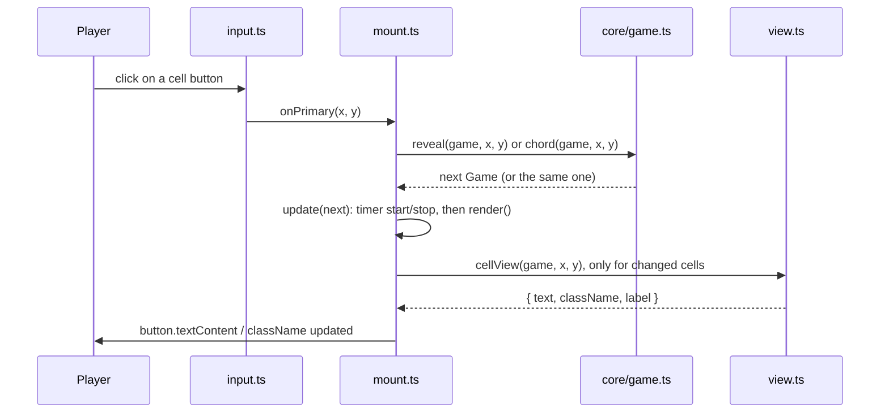

# Architecture

## Two layers, one rule

```
core/  the rules      data in → data out. No DOM, no clock, no Math.random unless injected.
ui/    the screen     turns events into core calls, and core state into pixels.
```

**The UI never decides rules.** It asks the core ("reveal this cell") and draws whatever comes back. The rules can then be tested without a browser, and reused by any other UI (a React version, a terminal version).

## The data model (`core/types.ts`)

A `Game` is a plain object: size, mine count, a 2D array of cells (`cells[y][x]`), and a status.

```
status:  ready ──first reveal──▶ playing ──▶ won
                                    └──────▶ lost
```

- **`ready`** means no mines yet. They're placed on the first reveal, so the first click is always safe.
- Everything is `readonly`. Functions never change a `Game`; they return a new one.

## Immutability and structural sharing

Changing one cell creates a new outer array and a new row, but **reuses every other row and cell** as-is. Two consequences that the rest of the code depends on:

1. **"Nothing changed" is one comparison.** Moves return the *same object* when they do nothing (revealing a revealed cell, chording without enough flags), so the UI checks `next === game` and skips all work.
2. **"Which rows changed" is one comparison per row.** An unchanged row is literally the same object as before.

Bulk changes (flood fill, placing mines) go through `updatePositions`, which groups positions by row and copies each changed row once instead of copying the board once per cell.

## What happens on a click



## Rendering: a cache with the right dependencies

`render()` remembers what's on screen (`renderedCells`, `renderedStatus`) and skips rows and cells whose objects didn't change. This is the same idea as `useMemo` in React.

**The trap:** after losing, every mine must appear, but the mine cells don't change. Only `status` does. So the cache depends on **cells and status**: if the status changed, the whole board is redrawn. A cache is only correct if it knows everything its result depends on.

## What a cell shows (`ui/view.ts`)

The core stores the truth; the view derives the display from it. The core never marks every mine as "revealed" on a loss: that would make `revealedCount` wrong and lose which mine exploded.

| Lost? | State | Mine? | Shows |
|---|---|---|---|
| no | hidden | — | `""` |
| no | flagged | — | 🚩 |
| no | revealed | no | number, or `""` |
| yes | hidden | yes | 💣 |
| yes | hidden | no | `""` |
| yes | flagged | yes | 🚩 |
| yes | flagged | no | ❌ |
| yes | revealed | yes | 💣 on red (the one that exploded) |
| yes | revealed | no | number, or `""` |
| won | hidden | yes | 🚩 (remaining mines get flagged) |

**During play, "mine?" must not matter.** If the display depended on it, inspecting the page would reveal the mines. `view.test.ts` checks this explicitly, and covers every row as a table-driven test (`it.each`).

## The UI pieces

| File | Responsibility |
|---|---|
| `mount.ts` | State, page structure, game flow (`startNewGame`, `update`), rendering, wiring |
| `input.ts` | Raw mouse/touch events → `onPrimary(x, y)` / `onFlag(x, y)`, using one listener per event type on the board (event delegation) |
| `stopwatch.ts` | Timer. Computes time from `Date.now()` instead of counting ticks, because browsers throttle intervals in background tabs |
| `view.ts` | Cell display (pure) |
| `difficulty.ts`, `format.ts` | Data and pure text helpers |

`mount()` and `attachCellInput()` follow the same contract: **set something up, and return a function that undoes it.** That's what lets a host page remove the game without leaving listeners or timers behind.

## Testing

- **Core:** every rule, including properties checked over many random games (the first click is never a mine; mines are uniform).
- **Randomness is injected** (`reveal(game, x, y, random)`), so tests pass a predictable sequence and get the same board every time.
- **View:** the decision table above, row by row. Test games are built by hand as plain objects; no need to play to reach a state.
- **Not yet automated:** the DOM layer. See the roadmap (end-to-end test with Playwright in M5).
